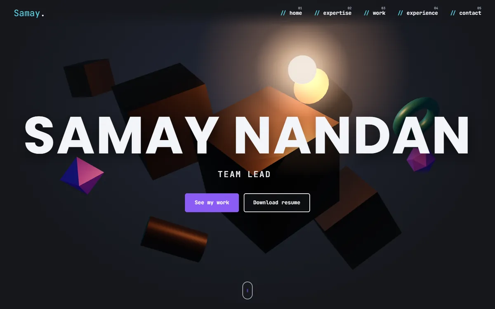

# Samay Nandan · Portfolio

Personal portfolio of **Samay Nandan**, Team Lead (engineering and delivery management, full stack, generative AI).
A dark, single-page site with a real-time 3D hero, case studies for client projects, and the delivery playbook I use to run them.



## What's on the site

- **3D hero** built with Three.js: floating geometry lit by a moving light, reacting to the mouse.
- **What I do**: people management, project and delivery management, technical leadership.
- **How I lead & deliver**: eight practices for running client projects, from first estimate to handover.
- **How a project moves through my team**: an animated delivery pipeline.
- **Project gallery**: nine case studies. Each card opens a popup with the problem, what I did, the result, an architecture diagram and the stack.
- **Problems I've solved**: real incidents and hard calls from client work.
- **Experience** timeline, client countries and a resume download.

## Tech stack

| Area | Tools |
| --- | --- |
| Framework | Next.js 15 (App Router, static export), React 19, TypeScript |
| 3D & motion | Three.js, CSS animation, SVG |
| Styling | Plain CSS with design tokens, Google Fonts (Poppins, JetBrains Mono) |
| Output | Static HTML/CSS/JS in `out/`, deployable to any static host |

No UI library and no CSS framework: the whole site is hand-written components and one stylesheet.

## Performance

- Three.js is loaded **after** first paint, so it never blocks the page.
- The 3D scene renders at a capped pixel ratio and frame rate, and pauses when scrolled out of view.
- Project images are resized WebP (about 30–60 KB each).
- Sections below the fold use `content-visibility` to skip work until they're near.
- Animations respect `prefers-reduced-motion`.

## Getting started

```bash
npm install
npm run dev      # http://localhost:3000
npm run build    # static site written to /out
```

## Editing content

All text lives in two files. You don't need to touch the components to change copy.

| File | What it holds |
| --- | --- |
| `content.ts` | Profile, hero lines, skills, delivery pipeline, projects (with diagrams), experience, client countries |
| `stories.ts` | "Problems I've solved" stories and the "How I lead & deliver" playbook |
| `public/Samay_Nandan_Resume.pdf` | The file served by the download buttons |
| `public/projects/` | Project screenshots (WebP) |

## Project structure

```
app/
  layout.tsx            page shell, metadata, fonts
  page.tsx              all sections of the page
  globals.css           design tokens and every style
components/
  Hero3D.tsx            Three.js hero scene
  ProjectGallery.tsx    project cards and case-study popup
  Diagram.tsx           SVG architecture diagrams from node/edge specs
  Pipeline.tsx          animated delivery pipeline
  Motion.tsx            scroll reveal and typed text
content.ts, stories.ts  site copy
```

## Deployment

`npm run build` produces a fully static site in `out/`. Deploy that folder to Vercel, Netlify, GitHub Pages or any web host.

## Contact

- Email: samaynandan@gmail.com
- GitHub: [Samay-Nandan](https://github.com/Samay-Nandan)

Client names are left out of most case studies on purpose, and no confidential client data is included.
